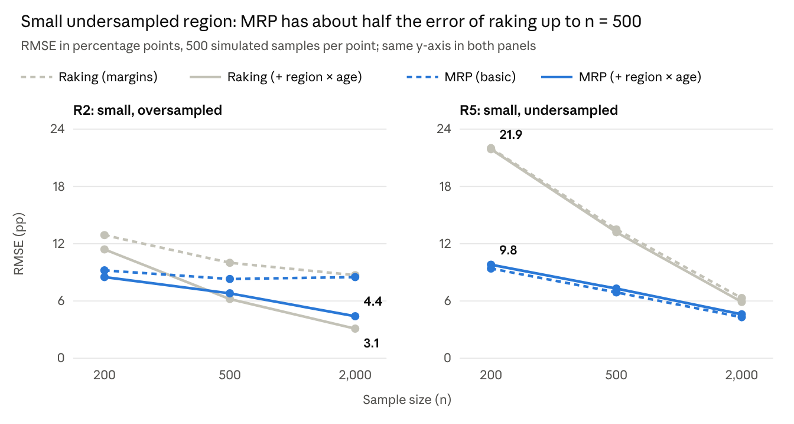

# When to use MRP instead of raking: evidence from a simulation

Zoltán Kmetty · 18 October 2026

## Summary

Use MRP when you need estimates for small subgroups, above all subgroups the sample under-covers, and when the sample is small. In our simulation MRP cut the error for a small, undersampled region by more than half at n = 200 (RMSE 9.4 vs. 21.9 percentage points for the better raking estimator). For national estimates the two methods converge once n reaches about 500, and raking on the right margins is as accurate as MRP and simpler.

Neither method removes a bias it is not told about. Raking fails when selection runs through a combination of variables that is not among its margins; MRP fails when the outcome depends on a combination its model leaves out. Adding the relevant interaction to either method (a joint margin in raking, a varying intercept in MRP) removes most of that bias.

One MRP specification choice paid off almost everywhere: entering ordered age as a linear fixed effect next to its varying intercept. It lowered MRP's error in 51 of 54 simulated conditions.

## Background: what MRP and raking do

Both methods correct a non-representative sample with known population information, but in different ways. Raking reweights: it adjusts each respondent's weight step by step until the weighted sample matches the population on every adjustment variable, then takes weighted means. MRP models: a regression predicts the outcome for every population cell (here every combination of age, gender, region and education), and the predictions are averaged with the cells' population counts as weights.

That second step, poststratification, is regression followed by summation over the population table (Gelman, Hill and Vehtari 2020, ch. 17). The multilevel part matters when there are many cells and few respondents per cell. Varying intercepts pool information across related cells, so a cell with two respondents borrows strength from similar cells instead of resting on those two people alone. Raking needs only the population margins; MRP needs the full joint cell counts.

Gelman, Hill and Vehtari state the condition plainly: the model adjusts for differences between sample and population "as long as the relevant adjustment variables are included as predictors in the regression, and as long as their distribution is known in the target population" (p. 313). Their fake-data example (section 17.2) uses a 32-cell population (sex × age × ethnicity) with non-response that is, in their words, "a particularly simple multiplicative model with no interactions" (p. 321), and fits an ordinary, non-multilevel logistic regression to 1,000 respondents. Selection of that kind is exactly what raking on single margins corrects, so in their setting every method in this paper works. This paper takes up the harder case: selection and outcome that both depend on an interaction, with many sparse cells.

Three further points from the chapter carry over. Their real-data example, an opt-in Xbox poll from 2012, used many interactions and a multilevel model, which fits many varying coefficients "in a way that is more stable than would be possible using least squares or maximum likelihood" (p. 320); they call the general approach "regularized prediction and poststratification". They attach an interval to every poststratified estimate from the posterior draws, and widen it with an extra error term (SD 2 points) because polls "can easily be off by 2 percentage points, merely due to nonresponse and changes of opinion" (p. 315). And they warn that "poststratification adjusts for specific discrepancies between sample and population and not others" (p. 319): in 2016 adjusted online polls missed some swing states by several points. Interval coverage is not evaluated in this paper.

## Simulation design

We simulated a population of 50,000 people and estimated support for party A, a yes/no outcome, from deliberately biased samples. Each person has an age group (4 levels), gender (2), region (5) and education (3), which gives 120 population cells. Two regions are small: R2 holds 8% of the population and R5 10%.

True support depends on all four characteristics plus a region × age interaction. In R2 young people are far less supportive than older people; in R5 the age pattern is reversed. True support is 47.9% nationally, 42.0% in R2 and 53.0% in R5.

Samples oversample young people and regions R2 and R3, and undersample R5. Selection also depends on the region × age combination, in the same direction as the outcome interaction: young people in R2 are oversampled further, young people in R5 undersampled further. We drew 500 samples each at n = 200, 500 and 2,000 and applied the same four estimators to every sample.

| Estimator               | Adjusts for                                                    | Implementation in R                                                                                      |
|-------------------------|----------------------------------------------------------------|----------------------------------------------------------------------------------------------------------|
| Raking (margins)        | age, gender, region and education, each separately             | `survey::rake` on the four population margins; weights trimmed at 5× the mean                              |
| Raking (+ region × age) | the joint region × age distribution, plus gender and education | as above, with region × age as one margin                                                                |
| MRP (basic)             | the four characteristics, additively                           | `lme4::glmer` with a varying intercept for each characteristic, poststratified to the 120 population cells |
| MRP (+ region × age)    | additionally each region × age combination                     | as above, plus a varying intercept for region × age                                                      |

We report bias and root mean squared error (RMSE) against the true population value, in percentage points. RMSE combines bias and sampling variability; lower is better.

Small samples are sparse. At n = 200 a typical sample leaves 50 of the 120 cells empty, and 85% of samples have at least one empty region × age cell. Raking on that joint margin is then impossible without merging cells; we merged each empty cell with the neighbouring age group in the same region.

## Result 1: small subgroups

*Simulation output (`rmse_grid_by_scenario.csv`), baseline selection, 500 samples per point; values printed for the two estimators with the region × age term.*

The gap comes from how few respondents a small, undersampled group has: R5 contributes about 7 respondents at n = 200 and 18 at n = 500. Raking has to give them very large weights, so its estimate swings widely from sample to sample; MRP borrows strength from the other regions and age groups.

In the oversampled region R2 the picture changes with sample size. MRP is better at n = 200, but raking with the region × age margin catches up at n = 500 and is more accurate at n = 2,000, where it has enough respondents and none of MRP's shrinkage.

## Result 2: national estimates

For the national figure the choice of method matters little. All four estimators remove most of the 9–10 point error of the unweighted mean, and at n = 2,000 their RMSEs lie between 1.5 and 1.8 points.

| n     | Unweighted | Raking (margins) | Raking (+ region × age) | MRP (basic) | MRP (+ region × age) |
|-------|------------|------------------|-------------------------|-------------|----------------------|
| 200   | 10.03      | 4.80             | **4.71**                | 5.27        | 5.28                 |
| 500   | 9.76       | 3.08             | **2.88**                | 3.16        | 3.21                 |
| 2,000 | 9.27       | 1.78             | **1.48**                | 1.54        | 1.56                 |

*RMSE in percentage points, 500 samples per row; lowest of the four adjusted estimators in bold.*

Standard MRP trails raking slightly at n = 200 because its varying intercepts shrink the strong age effect towards zero (bias −2.7 points). With ordered age also entered as a linear fixed effect, MRP reaches 4.43, 2.78 and 1.47 points, matching or beating the best raking estimator.

## Result 3: what the adjustment must include

Raking and MRP fail under opposite conditions. To show this we varied how strongly selection depends on the region × age combination, keeping the population fixed, and looked at bias in R2 at n = 2,000.

| Region × age term in selection | Unweighted | Raking (margins) | Raking (+ region × age) | MRP (basic) | MRP (+ region × age) |
|--------------------------------|------------|------------------|-------------------------|-------------|----------------------|
| Strong (baseline)              | −16.3      | −8.3             | −0.4                    | −8.2        | −3.6                 |
| Half as strong                 | −13.9      | −4.5             | −0.2                    | −6.4        | −2.6                 |
| None                           | −10.6      | +0.2             | 0.0                     | −4.4        | −1.6                 |

*Bias in percentage points, region R2, n = 2,000, 500 samples per row.*

Raking on single margins is unbiased once selection runs only through single characteristics, whatever the outcome looks like. Basic MRP stays biased even then (−4.4 points), because the outcome has an interaction its model ignores. Raking needs the right margins; MRP needs the right model.

Adding the interaction fixes most of the problem in both methods. Raking on the region × age margin is practically unbiased in every row. MRP with a region × age intercept halves its bias but keeps −1.6 to −3.6 points, because partial pooling shrinks large interaction effects in cells with few respondents; R2's over-60s have about ten respondents even at n = 2,000.

## Decision guide

The deciding questions are which estimate you need, how well the sample covers it, and whether you can describe the selection with the adjustment variables.

| Situation                                                                    | Prefer                                                     | Evidence from the simulation                                                                                                                   |
|------------------------------------------------------------------------------|------------------------------------------------------------|------------------------------------------------------------------------------------------------------------------------------------------------|
| Estimates for small subgroups that the sample under-covers                   | MRP                                                        | Small undersampled region: RMSE 9.4 vs. 21.9 (n = 200), 6.9 vs. 13.2 (n = 500), 4.3 vs. 5.9 (n = 2,000)                                        |
| Subgroup estimates from a small sample (n ≤ 500)                             | MRP                                                        | At n = 200 raking's error is 11–22 points in the two small regions vs. 8.5–9.8 for MRP, and the joint margin has empty cells in 85% of samples |
| Subgroups the sample covers well, n ≥ 500, joint population margin available | Raking with that joint margin, or MRP with the interaction | Small oversampled region at n = 2,000: RMSE 3.1 (raking) vs. 4.4 (MRP)                                                                         |
| National figure only, n ≥ 500                                                | Raking (simpler, same accuracy)                            | National RMSEs within about 0.3 points of each other                                                                                           |
| Selection plausibly depends on a combination of variables                    | Either, but add that combination                           | Bias falls from about −8 to near 0 (raking) or to −3.6 (MRP); see Result 3                                                                     |
| Only single-variable population margins are known                            | Raking on margins                                          | Not tested here: MRP needs the full joint population cell counts                                                                               |

If you use MRP, three specification choices helped. Enter ordered variables such as age as a linear fixed effect plus a varying intercept; this lowered error in 51 of 54 conditions. Keep the varying intercept as well: it absorbs non-linear age patterns, the reason Gelman, Hill and Vehtari enter age as a factor (p. 318). Treat two-level variables such as gender as fixed effects; accuracy is unchanged but singular fits become rarer. Predict and poststratify every population cell, including cells with no respondents.

## Limitations and replication

These results come from one simulated population in which selection depends only on the four adjustment variables. In the terms of Gelman, Hill and Vehtari (2020, pp. 322–324), selection is ignorable, or "missing at random", given the 120 cells. In real surveys selection can also run through unmeasured factors, which neither method corrects; this cannot be proven from the data, and the practical defence is to adjust for as many relevant variables as possible. We evaluated point estimates only, not the coverage of confidence or credible intervals.

Two robustness checks support the conclusions. With a non-linear region × age pattern (a mid-age peak in R2, a U-shape in R5), MRP remained far more accurate for the undersampled region (RMSE 11.5 vs. 20.3 at n = 200) and the methods again converged nationally. A Bayesian refit with `rstanarm` on 20 samples per condition reproduced the `lme4` results within 0.8 points.

The R code (tidyverse, survey, lme4) and all results are in the [mrp_raking_simulation folder](https://github.com/IstatConsulting/public/tree/claude/mrp-raking-simulation-2vonfp/mrp_raking_simulation). One scenario of 1,500 samples runs in about 8 minutes on four cores.

## References

Gelman, A., Hill, J. and Vehtari, A. (2020). *Regression and Other Stories*. Cambridge University Press. Chapter 17, "Poststratification and missing-data imputation", pp. 313–335. [Free PDF](https://users.aalto.fi/~ave/ROS.pdf); [example code for chapter 17](https://github.com/avehtari/ROS-Examples/tree/master/Poststrat).
